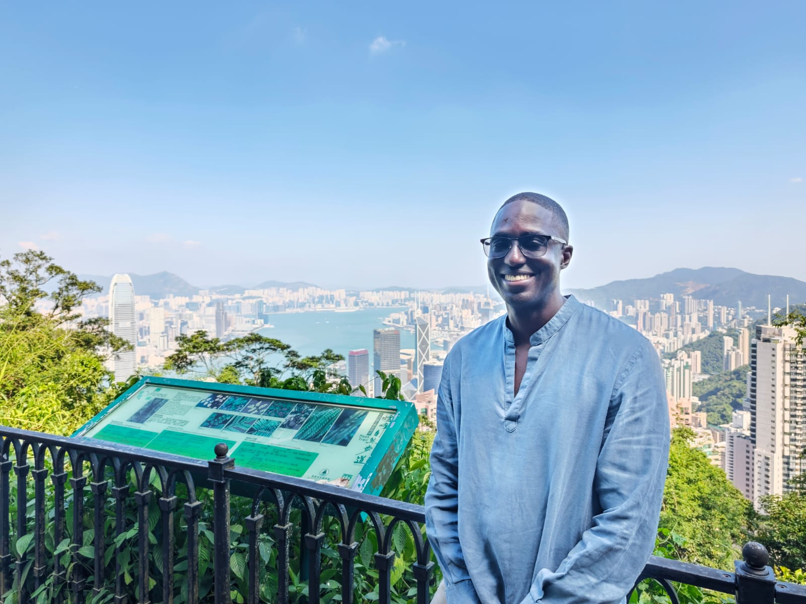

I’m Cheikh, a climate and Earth-system scientist, engineer, and research leader based in Castries, Saint Lucia. I founded and lead [Elizabeth Consulting International Inc.](https://www.ec-intl.com), and serve as Project Manager, Research Scientist, and Model Products Lead at the [Climate Modeling Alliance](https://clima.caltech.edu) at Caltech.

My research focuses on atmospheric circulation, storm tracks, and the connections between tropical and extratropical climate. Alongside that research, I work on scientific software, climate-data systems, and practical information for engineers, planners, and researchers. My growing focus is climate risk and adaptation in small island developing states.

I enjoy bringing scientific and software teams together around a clear question, a useful product, and a shared definition of what it means to finish the work. My approach combines iterative development, explicit acceptance criteria, and PRINCE2 Agile project-management principles.

I have served on the Commonwealth Caribbean Rhodes Scholarship selection committee and review research for scientific journals. In January 2026, I led a session at the SIDSCI workshop mapping climate challenges facing island communities.

In 2026, I served as a chapter reviewer for Working Group I of the IPCC Seventh Assessment Report. On 12 October, I gave an invited presentation at the Chinese University of Hong Kong on connecting climate models to adaptation decisions, with a focus on confidence, uncertainty, and the gaps between scientific information and its use.

I enjoy playing video games, reading non-fiction books, and spending time with my family and friends in my spare time. I also like to play cricket, practice karate, and run. Finally, I enjoy listening to classical music, playing my viola, and visiting museums.

***

### Select Awards

2009 : Donald Wills Douglas Fellowship, California Institute of Technology

2006 : Dennis H. Mahan Award

2006 : [The Commonwealth Caribbean Rhodes Scholarship](https://www.rhodeshouse.ox.ac.uk/scholarships/the-rhodes-scholarship/)

2005 : The Cadet Roger A. Herndon Memorial Award

1998 : Graduation prize for the study of Principles of Business and Information Technology
