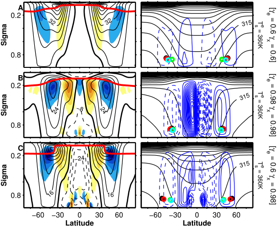
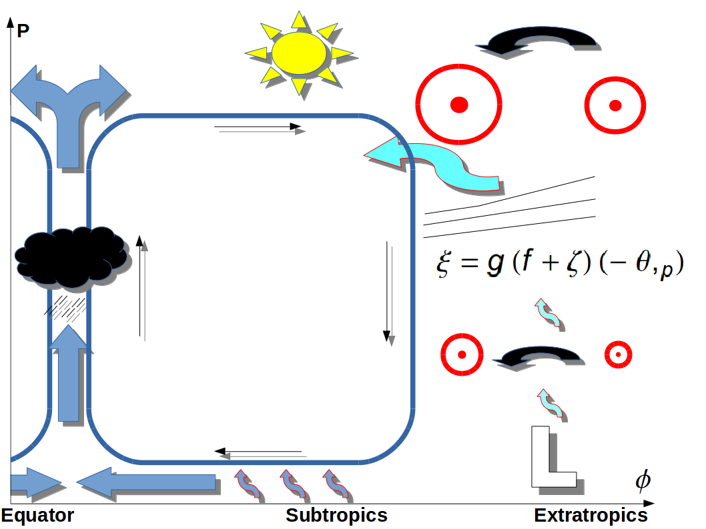

## Climate Modeling and Scientific Software

At CliMA, I am the project manager for the development of the CliMA Earth system model, and I lead the work on its model products. I am also contributing to a study, in preparation, that uses a Julia-based climate model across hierarchies of scale and complexity.

My work at CliMA includes project management for the atmosphere model described in our 2026 paper, [The Climate Modeling Alliance Atmosphere Dynamical Core: Concepts, Numerics, and Scaling](https://doi.org/10.1029/2025MS005014).

## Midlatitude Storm Tracks and Climate Change

**Q: What are midlatitude storm tracks?**
A: Midlatitude storm tracks are regions with the most intense extratropical cyclones and anticyclones. Storm tracks are important because most poleward energy and angular momentum transport in midlatitudes occurs there. Put another way, the storm tracks control the weather and climate of Earth's mid-latitudes.

**Q: How will climate change affect storm tracks?**
A: The storm-track response to climate change varies by season, timescale, hemisphere and region. The [IPCC AR6 Working Group I Technical Summary](https://www.ipcc.ch/report/ar6/wg1/chapter/technical-summary/) assesses a likely poleward shift and strengthening of the Southern Hemisphere midlatitude jet, with a strengthening storm track, by 2100 under high CO₂ emissions. It assigns low confidence to projected poleward shifts of Northern Hemisphere jets and storm tracks because of internal variability and differences among models.

**Q: Why should we care about changes in the storm tracks?**
A: Changes in the storm tracks have broad implications for water availability, energy production, and severe weather patterns in mid-latitudes.

### Summary of Storm Track Research

Although the storm-track response to climate change is important, the dynamics underpinning storm-track shifts still need to be better understood. Therefore, we seek to understand what controls storm-track shifts. To answer this question, we use models of varying complexity to test and develop theories of storm-track changes. To that end, we have demonstrated that deep-tropical forcing can shift storm tracks and that dry dynamics explain a substantial proportion of storm-track shifts ([Mbengue and Schneider, 2013](https://doi.org/10.1175/JCLI-D-13-00404.1)). Further progress was made when we used a novel method to show that changes in near-surface meridional temperature gradients dominate storm-track shifts ([Mbengue and Schneider, 2017](https://doi.org/10.1175/JAS-D-15-0267.1)). These results are corroborated by Baker et al. (2017). Building on these results, [Mbengue and Schneider (2018)](https://doi.org/10.1175/JAS-D-17-0098.1) developed a simple conceptual model that shows how convection in the tropics can lead to storm-track shifts, especially in circumstances where changes in deep tropical convective stability suffice to shift the storm tracks.

**Figure 1.** Sample of simulated climates as the convective stability is varied: (a) Most stable and (b) least stable global climate. (c) stable tropical climate. (left) Mean zonal wind (black contours), eddy momentum flux divergence (filled contours; yellow is positive), and tropopause [thick red line, World Meteorological Organization (WMO) criterion]. (right) Potential temperature (black contours), mass flux streamfunction (blue contours). Compare (a) with (c) for the response to tropical convective stability changes and (a) with (b) for the response to global convective stability changes. The circles show the location of the storm tracks as indicated by extrema in barotropic eddy kinetic energy (red), meridional eddy potential temperature flux (green), vertical heat flux (cyan), and surface westerlies (black).

## Tropical-Extratropical Interactions

**Q: What are tropical-extratropical interactions?**
A: This stream of research seeks to understand whether and how changes in tropical regions lead to or are influenced by corresponding changes in extratropical areas.

**Q: How does one tackle this type of question?**
A: It is tricky because the climate system is coupled, so one must carefully disentangle causes and effects. We separate potential influences by using a hierarchy of mathematical models to represent the minimum number of essential processes. We use these models to test our hypotheses and gradually build scientific theories. Generally, we use statistical methods to identify potential drivers of known effects or modes of variability in an observed record. Once we've identified a possible driver, a hypothesis is devised that links the cause and effect. Then, we use statistical methods or the hierarchy of models to test the hypothesis.

### Summary of Tropical-Extratropical Interactions Research

We noticed that the North Atlantic and European sector seasonal-forecast skill is better in winter than in summer for some forecast variables in weather and climate models. Hence, we seek to understand why this is the case and devise methods to improve the seasonal-forecast skill in models. We analyzed the eddy-driven jet's sensitivity to diabatic heating during the summertime. Our results showed that the summer jet responds to a broad range of heating and that it also responds to heating in the tropics (see Baker et al., 2017)--an extratropical response to tropical forcing. Our investigations have also shown notable differences in the feedback associated with diabatic heating in the east versus west Atlantic (Woollings et al., 2016).

**Figure 2.** A possible mechanism for tropical driving of midlatitude stability anomalies, which influence eastward propagating midlatitude weather systems.
